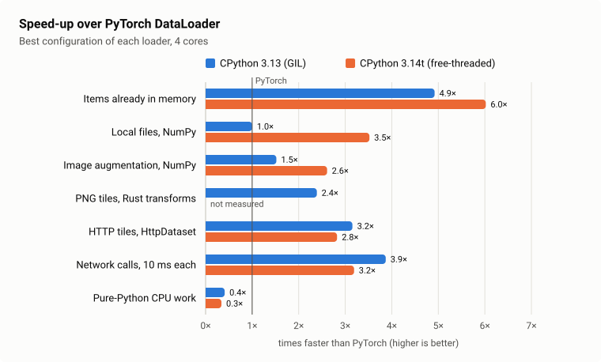
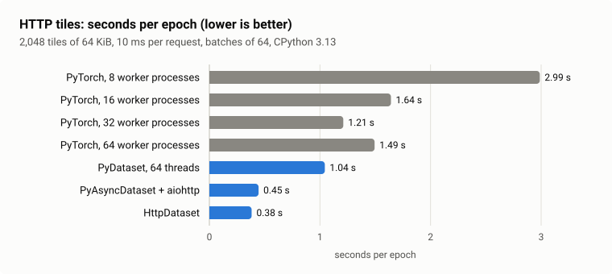
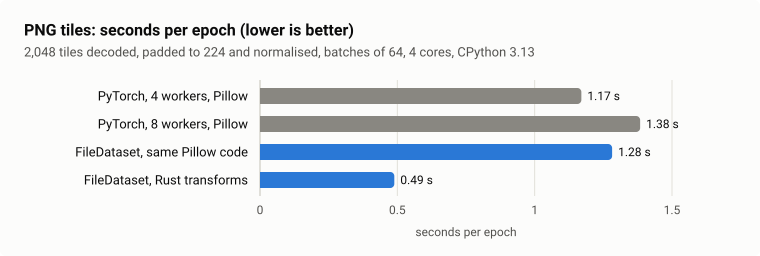

# Benchmarks

These benchmarks compare `dataloader_rs.PyDataloader` with `torch.utils.data.DataLoader` on the
same dataset code, each loader in its best configuration (number of workers, and requests in
flight for network data). All numbers come from one Intel Core i9-13900H laptop running Linux,
with the loaders pinned to 4 cores (the size of a GitHub-hosted CI runner; 12 hardware threads
for the HTTP tiles), on CPython 3.13 with the GIL and free-threaded CPython 3.14t; each value is the median of
whole epochs.

## Speed-up over PyTorch

<picture><source media="(prefers-color-scheme: dark)" srcset="bench/charts/speedup-dark.svg"></picture>

dataloader-rs is faster on every workload whose work happens outside the Python interpreter:
loading itself, NumPy, image decoding and network I/O. The free-threaded build helps most where
the per-item Python code is short but not free, such as reading a file and normalising it with
NumPy.

<details><summary>Numbers</summary>

| Workload | What each item does | 3.13 | 3.14t |
|---|---|---:|---:|
| Items already in memory | returns its index: the loader's own cost | 4.92× | 6.02× |
| Local files, NumPy | reads a 16 KB file, normalises it to float32 | 1.00× | 3.52× |
| Image augmentation, NumPy | crops, flips and normalises a 3×128×128 image | 1.52× | 2.61× |
| PNG tiles, Rust transforms | decodes, pads and normalises a 224×224 PNG | 2.39× | not measured |
| HTTP tiles, HttpDataset | fetches 64 KiB from a server answering after 10 ms | 3.15× | 2.82× |
| Network calls, 10 ms each | a blocking 10 ms wait, like an object-store GET | 3.87× | 3.19× |
| Pure-Python CPU work | tokenises text with a shared Python dictionary | 0.41× | 0.34× |

</details>

## HTTP tiles

<picture><source media="(prefers-color-scheme: dark)" srcset="bench/charts/http-tiles-dark.svg"></picture>

PyTorch keeps one request in flight per worker process, and stops improving beyond 32 processes;
dataloader-rs keeps 64 in flight with 2 workers of 32 concurrent requests each, and `HttpDataset`
is 3.2 times faster than PyTorch's best. On 3.14t, the 64 `PyDataset` threads also reach 0.48 s, because they no longer
take turns on the GIL.

<details><summary>Numbers</summary>

Seconds per epoch, a fresh loader for each epoch. The 32 and 64 worker runs come from a second
session of the same script, where 16 workers took 1.69 s.

| Loader (requests in flight) | 3.13 | 3.14t |
|---|---:|---:|
| PyTorch, 8 worker processes (8) | 2.99 | 2.98 |
| PyTorch, 16 worker processes (16) | 1.64 | 1.66 |
| PyTorch, 32 worker processes (32) | 1.21 | 1.24 |
| PyTorch, 64 worker processes (64) | 1.49 | 1.50 |
| `PyDataset`, 4 workers × 16 threads (64) | 1.04 | 0.48 |
| `PyAsyncDataset` + aiohttp, 2 × 32 (64) | 0.45 | 0.45 |
| `HttpDataset`, 2 × 32 (64) | 0.38 | 0.38 |

</details>

## PNG tiles

<picture><source media="(prefers-color-scheme: dark)" srcset="bench/charts/image-tiles-dark.svg"></picture>

The Rust image transforms are 2.4 times faster than PyTorch with Pillow and torchvision, use 2.4
times less CPU time, and produce the same values bit for bit. The same Pillow code run as a
Python transform is no faster than PyTorch: the speed-up comes from leaving the interpreter.

<details><summary>Numbers</summary>

| Loader | Seconds per epoch (3.13) |
|---|---:|
| PyTorch, 4 worker processes, Pillow + torchvision | 1.17 |
| PyTorch, 8 worker processes, Pillow + torchvision | 1.38 |
| `FileDataset`, 4 × 4, the same Pillow code as `transform=` | 1.28 |
| `FileDataset`, 4 × 4, `dataloader_rs.transforms` + `ImageCollator` | 0.49 (0.47 on 3.14t) |

</details>

## When PyTorch is faster

The workers of dataloader-rs are threads in one process. When `__getitem__` spends its time in
pure Python code, threads take turns on the GIL of CPython 3.13 and slow each other down on
shared objects on 3.14t, while PyTorch's processes share nothing: on a tokenisation workload,
PyTorch is 2.4 times faster on 3.13 and 2.9 times faster on 3.14t, and on 3.14t dataloader-rs
becomes 1.16 times faster once each thread keeps its own tables (`threading.local`). With items
that cost nothing, worker threads cost more than they save: on 3.13, 4 workers deliver 5.6 M items
per second against 6.0 M for PyTorch without workers, so keep `num_workers=0` there (29 M items
per second).

## First batch

A fresh dataloader-rs loader delivers its first batch of HTTP tiles after about 0.03 s, a fresh
PyTorch loader after 0.8 to 1.3 s, because it starts its worker processes and one of them fetches
a whole batch.

> Tip: with NumPy arrays on Linux, and most of all on free-threaded builds, the allocator's
> settings change the results; [bench/README.md](bench/README.md#allocator-settings) gives the
> ones these benchmarks use.

## Reproduce

```bash
uv sync --group dev
uv run maturin develop --release
uv pip install torch torchvision --index-url https://download.pytorch.org/whl/cpu

# The Rust loader alone (Criterion); reports in target/criterion/
taskset -c 0,2,4,6 cargo bench --features http,image

# Against PyTorch: in-memory, files, augmentation, network calls, pure Python
taskset -c 0,2,4,6 uv run python -X gil=0 bench/compare_torch.py --workers 4 --repeats 5 --json torch.json
# HTTP tiles (a local tile server on CPUs 12-19, the loaders on 0-11)
uv run python -X gil=0 bench/compare_async.py --rounds 7 --json async.json
# PNG tiles (writes the tiles under --dir first)
taskset -c 0,2,4,6 uv run python bench/compare_image.py --dir ~/tiles --rounds 5 --json image.json

# Charts, from bench/results/summary.json
python bench/charts.py
```

Run the same commands with `uv run --python 3.13 python ...` (without `-X gil=0`) for the GIL
build. Each `--json` file holds every measurement of a run; the values plotted here are in
[bench/results/summary.json](bench/results/summary.json). The CI runs the regression benchmarks
on every pull request and plots them per commit for
[Rust](https://azhicham.github.io/dataloader-rs/benchmarks/rust/) and
[Python 3.14t](https://azhicham.github.io/dataloader-rs/benchmarks/python-3.14t/).
[bench/README.md](bench/README.md) and [benches/README.md](benches/README.md) describe every
benchmark.
